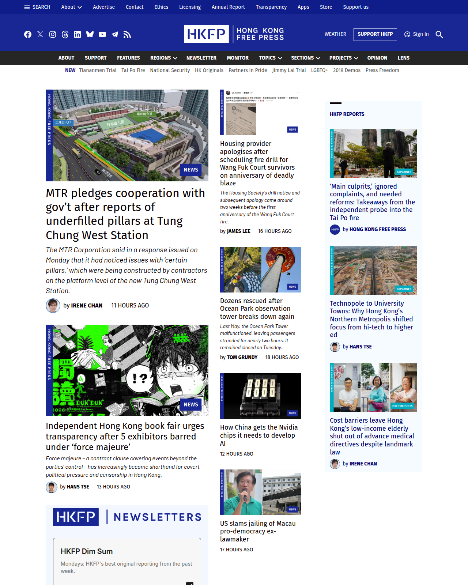

>
Founded in 2015, Hong Kong Free Press is an impartial, non-profit, award-winning English-language newspaper.
Run by journalists, backed by readers and 100% independent, HKFP is governed by a public code of ethics. (Web site: https://hongkongfp.com/)

A screenshot of https://hongkongfp.com/ as of 10 November 2026 (the homepage led with MTR's response to reports of underfilled pillars at Tung Chung West Station, the Housing Society's apology for scheduling a fire drill for Wang Fuk Court survivors, and takeaways from the independent probe into the Tai Po fire):

## Archives
(State: In Progress)

- [.WaCZ as of 03-05-2022](https://bafybeighmfirp4em5q25z7uselszxz2573ipxchwsdwvdkl7ldnsubwy54.ipfs.dweb.link/fixtures/hkfp-05_03_2022.wacz) ([[howto.replay]])
- [Wayback Machine](https://web.archive.org/web/*/http://www.hkfp.com/)