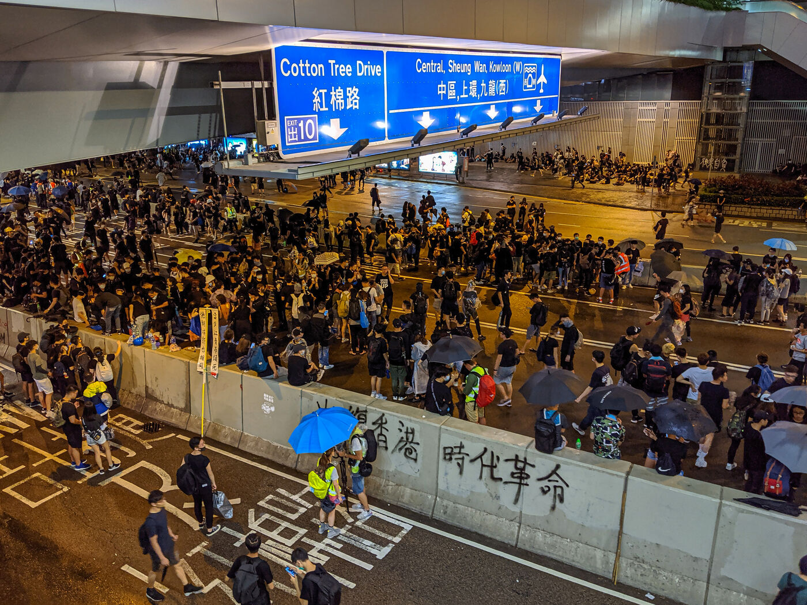

*Protesters gather near Cotton Tree Drive (紅棉路), Admiralty, during Hong Kong's anti-extradition-bill protests, 18 August 2019 — the road barrier marked with the movement's slogan "光復香港 時代革命" (Liberate Hong Kong, Revolution of Our Times). Photo: Studio Incendo, [CC BY 2.0](https://creativecommons.org/licenses/by/2.0/), via [Wikimedia Commons](https://commons.wikimedia.org/wiki/File:Hong_Kong_protests_-_IMG_20190818_202037.jpg).*

Since 2020, Hong Kong has been subject to the National Security Law imposed by the central government, sparking strong backlash from both local and international communities.

In the wake of the law’s implementation, civil society in Hong Kong has suffered devastating setbacks—not only through the arrest or exile of key activists, but also through the dismantling of their projects and the loss of public information channels.

The idea for SHKO emerged from a shared concern over a series of crackdowns in Hong Kong, including the disappearance of independent media outlets and the forced shutdown of numerous non-governmental organizations. With the list of endangered projects growing rapidly, civil society has had little time or capacity to respond—particularly in preserving the legacy content and historical records, whether digital or physical, of these suppressed entities.

In response, a group of digital activists has launched a new initiative in collaboration with this project. Their mission is to build open-source tools that can preserve these clusters of historically significant content and establish a replicable model for use in similar politically sensitive environments.

The immediate goal is to collect and archive at-risk content from affected organizations, creating a publicly accessible online archive. Long-term, the project aims to ensure this content remains available for at least a decade or more, safeguarded through decentralized and crowd-supported means.

Ultimately, the project seeks to establish a preservation model that is open, transparent, and reusable. All tools and methodologies—excluding any private participant information—will be open-sourced, enabling others around the world to adopt and adapt the framework for their own preservation efforts.

## references

- [Free media in Hong Kong almost completely dismantled](https://www.theguardian.com/world/2022/apr/26/free-media-in-hong-kong-almost-completely-dismantled-report?CMP=twt_a-world_b-gdnworld)
- [Hong Kong’s Human Rights Press Awards cancelled, citing legal risks](https://hongkongfp.com/2022/04/25/breaking-hong-kongs-human-rights-press-awards-cancelled/) 
- [World Press Freedom Day: Hong Kong nosedives in press freedom ranking – below Cambodia, Somalia, Sri Lanka](https://web.archive.org/web/20220505015738/https://hongkongfp.com/2022/05/03/world-press-freedom-day-hong-kong-nosedives-in-press-freedom-ranking-below-cambodia-somalia-sri-lanka/)
