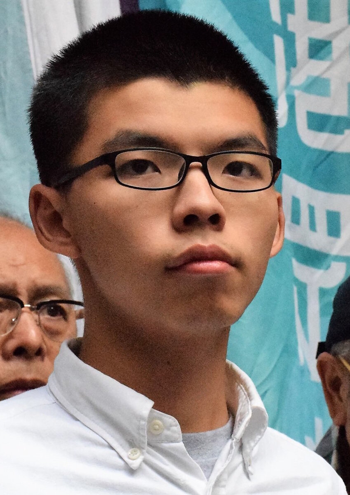

Related: [[Faces of the Crackdown|faces-of-the-crackdown]] | [[The Hong Kong 47|hong-kong-47]] | [[Hong Kong Alliance|sites.hka]] | [[Chow Hang-tung|faces-of-the-crackdown.chow-hang-tung]] | [[⚖️ Jimmy Lai|faces-of-the-crackdown.jimmy-lai]]

*Joshua Wong Chi-fung in 2017. Photo: Voice of America, public domain, via [Wikimedia Commons](https://commons.wikimedia.org/wiki/File:Joshua_Wong_Chi-fung,_2017_(cropped).jpg).*

**Joshua Wong Chi-fung** (黃之鋒, born 13 October 1996) is the best-known figure of Hong Kong's youth protest movement — the schoolboy activist who became the global face of the **2014 Umbrella Movement** and, a decade later, one of the most heavily prosecuted people under the National Security Law. He has been **in custody since 2020**, is serving a sentence in the [[Hong Kong 47|hong-kong-47]] subversion case, and on **5 November 2026 was given a further 10 years** after pleading guilty to a **second national-security charge** — foreign collusion — which the court found "**of a grave nature**."

## The student who took on Beijing

Wong first came to prominence at **15**. In 2011 he co-founded the student group **Scholarism** (學民思潮); in 2012 he led the campaign against a compulsory "moral and national education" curriculum critics saw as pro-Beijing indoctrination, drawing a rally of some **100,000 people** and forcing the government to shelve the plan.

Two years later he was a leading face of the **2014 Umbrella Movement**, the 79-day occupation demanding genuine universal suffrage. His arrest during the storming of Civic Square helped trigger the sit-ins. The image of a bespectacled teenager facing down Beijing made him internationally famous — named to *Time*'s "25 Most Influential Teens," later the subject of the Netflix documentary *Joshua: Teenager vs. Superpower* (2017), and in **2018 nominated for the Nobel Peace Prize** alongside fellow Umbrella leaders.

## Demosistō and disqualification

In 2016 Wong co-founded the pro-democracy party **Demosistō** (香港眾志) with **Nathan Law** and **Agnes Chow**, campaigning for Hong Kong's right to self-determination. He was repeatedly barred from running for or holding office. On **30 June 2020**, hours before the National Security Law took effect, Wong, Law and Chow quit the party and Demosistō disbanded — its parting message: "We will meet again."

## A decade in and out of prison

Even before the NSL, Wong was jailed again and again over the protests he led — for the 2014 storming of **Civic Square**, for contempt over the Mong Kok occupation, for organising the June 2019 siege of **police headquarters** during the anti-extradition-bill movement, and for attending banned **June 4th vigils**. He has been continuously imprisoned since December 2020.

## The Hong Kong 47

Wong was among the [[Hong Kong 47|hong-kong-47]] — the democrats prosecuted for organising the 2020 opposition **primary election**. He **pleaded guilty** to conspiracy to commit subversion and, in **November 2024**, was sentenced to **4 years 8 months**. He had been due for release in **2027**.

## A second case — another ten years

On **6 June 2025**, while already in prison, Wong was hit with a **fresh charge**: conspiracy to **collude with foreign forces**. Prosecutors say that in 2020 he lobbied foreign governments — chiefly the United States — to **impose sanctions or a blockade** on Hong Kong and China, and kept up that campaign after the NSL made it a crime.

On **2 September 2026** Wong **pleaded guilty** to the charge at the High Court. The offence carries **three to ten years**, rising to **up to life imprisonment** if the court finds it "of a grave nature" — meaning the 29-year-old, rather than walking free in 2027, could face many more years behind bars ([HKFP](https://hongkongfp.com/2026/09/02/breaking-jailed-hong-kong-pro-democracy-campaigner-joshua-wong-pleads-guilty-to-foreign-collusion-charge/) · [Al Jazeera](https://www.aljazeera.com/news/2026/9/2/hong-kong-activist-joshua-wong-pleads-guilty-in-national-security-case) · [RFA](https://www.rfa.org/english/china/2026/09/02/joshua-wong-guilty-plea-hong-kong-national-security-law/)).

On **5 November 2026**, at the High Court before NSL-designated judge **William Tam Yiu-ho** (譚耀豪), Wong — who had turned **30** in October and been **remanded over 2,100 days** — was sentenced to **10 years' imprisonment**. In mitigation his senior counsel **Chan Ching-lung** (陳政龍) had argued the case was **less grave than Jimmy Lai's** and belonged in the ordinary **3-to-10-year** band, with a one-third discount for the guilty plea and a further reduction for the prosecution's delay (the probe opened only in late 2023). The judge **rejected** that framing: he ruled the offence **"of a grave nature" (罪行重大)** — the finding that opens the **10-years-to-life** band — holding that Wong and **Nathan Law** had **continued** their sanctions campaign after the NSL took effect, gravely endangering national security. Tam took a **starting point of 13 years** and, crediting the early plea, came down to the **10-year statutory minimum** that a grave offence cannot fall below. Only **2 months and 2 days** of the term runs **concurrently** with Wong's [[Hong Kong 47|hong-kong-47]] sentence; the remainder is **consecutive**. Having been due for release in **January 2027**, he is now expected to remain imprisoned until **November 2036**, when he will be 40 ([HKFP](https://hongkongfp.com/2026/11/05/breaking-jailed-hong-kong-activist-joshua-wong-sentenced-to-10-years-over-foreign-collusion/) · [CNN](https://www.cnn.com/2026/11/04/china/hong-kong-china-joshua-wong-sentence-hnk-intl) · [The Witness](https://thewitnesshk.com/%E9%BB%83%E4%B9%8B%E9%8B%92%E8%AA%8D%E4%B8%B2%E8%AC%80%E5%8B%BE%E7%B5%90%E5%A4%96%E5%9C%8B%E5%8B%A2%E5%8A%9B-11%E6%9C%885%E6%97%A5%E6%97%A9%E4%B8%8A9%E6%99%82%E5%8D%8A%E5%88%A45/) · [HK01](https://www.hk01.com/%E6%94%BF%E6%83%85/60385666/%E9%BB%83%E4%B9%8B%E9%8B%92%E6%89%BF%E8%AA%8D%E4%B8%B2%E8%AC%80%E5%8B%BE%E7%B5%90%E5%A4%96%E5%9C%8B%E5%8B%A2%E5%8A%9B-%E8%A2%AB%E5%88%A4%E5%9B%9A10%E5%B9%B4-%E5%AE%98%E6%8C%87%E5%B1%AC%E7%BD%AA%E8%A1%8C%E9%87%8D%E5%A4%A7)).

In the public gallery, consular officials from **Sweden, Italy, the Netherlands and the EU** looked on; veteran activist **Lei Yuk-lin** (雷玉蓮), who had queued for a seat since the Tuesday, carried a gold heart-shaped candle for Wong, and the **102-year-old "Uncle Wong" (大黃伯)** was again among those lining up before dawn ([The Witness](https://thewitnesshk.com/%E5%AF%A6%E6%99%82%E6%9B%B4%E6%96%B0-%E9%BB%83%E4%B9%8B%E9%8B%92%E8%AA%8D%E4%B8%B2%E8%AC%80%E5%8B%BE%E7%B5%90%E4%BB%8A%E5%88%A4%E5%88%91-%E9%9B%B7%E7%8E%89%E8%93%AE%E5%B8%B6%E9%87%91%E5%BF%83%E5%88%B0/)).

### The reaction

The sentence drew a coordinated official response. Chief Executive **John Lee** (李家超) called Wong, the exiled **Nathan Law** and their affiliates "among the **primary culprits** responsible for undermining Hong Kong's prosperity and stability," accusing them of begging foreign powers to sanction the city; a government spokesperson said the ruling shattered the illusion that security offenders could escape liability under the cloak of "international advocacy," and that the authorities would **confiscate property related to Wong's offence** ([Dim Sum Daily](https://www.dimsumdaily.hk/government-spokesman-and-john-lee-back-joshua-wongs-10-year-sentence-and-vow-strict-national-security-enforcement/) · [The Standard](https://www.thestandard.com.hk/news/article/347643/John-Lee-labels-Joshua-Wong-as-primary-culprit-in-undermining-HK-stability)). Security Secretary **Chris Tang** (鄧炳強) said the term reflected the offence's gravity and that the government would study the judgment with the Department of Justice before deciding whether to appeal; he reserved his "strongest condemnation" for the "external forces" criticising the verdict — "the very forces," he said, "Wong and Law tried to collude with." Asked whether Wong could join in-custody rehabilitation, Tang said "of course," pointing to a prisoners' "**Walking With You**" (陪你前行) programme he hoped would help Wong grasp "how he was incited and **sold out by the US and the West**" ([Now News](https://news.now.com/mobile/local/player?newsId=668492)). National-security police chief **Steve Li Kwai-wah** (李桂華) said the investigation — opened on 2023 intelligence and charged two years later — had not been delayed, urged Wong to "properly understand his own country," and called on Nathan Law, now in the UK, to **return and surrender**.

The official framing did not go unchallenged. In a statement sent from prison, Wong said a national-security officer had told him they were "enemies"; asked about it, Li replied he personally would not regard Wong as an enemy — "He is an offender." **Amnesty International**'s deputy regional director **Sarah Brooks** said the sentence "cruelly — and perhaps deliberately — comes mere months before he would have been eligible for release," called the security law "a tool to punish dissent rather than to genuinely protect national security," and renewed Amnesty's call to overturn Wong's convictions ([HKFP](https://hongkongfp.com/2026/11/05/truly-reflective-of-his-offence-police-welcome-10-year-prison-sentence-for-activist-joshua-wong-amid-intl-outcry/)).

## Even the film is under review (2026)

Wong's story reached a global audience through **_Joshua: Teenager vs. Superpower_** (2017), the 78-minute Netflix documentary by American director **Joe Piscatella** that follows his Scholarism years and features **Nathan Law** and **Agnes Chow**. Nearly a decade on, the film itself became a target. On **15 September 2026**, Hong Kong's **Security Bureau** said it was "**taking follow-up action**" over the documentary — still streamable in the city, rated 13+ — stressing that "**all films broadcast in the city must meet Hong Kong law**," including the National Security Law and the 2024 Safeguarding National Security Ordinance. Whether any act amounts to a crime, it said, "depends on the facts and circumstances of each case" and "cannot be judged in the abstract"; if violations were found, "law-enforcement agencies will act according to the law" ([Dim Sum Daily](https://www.dimsumdaily.hk/security-bureau-reviewing-netflix-film-on-joshua-wong/)).

Back in 2020, as the NSL took effect, Netflix had signalled it would not "**proactively**" pull the film and would act only on a formal government takedown request ([HKFP](https://hongkongfp.com/2020/07/10/security-law-netflix-will-not-proactively-remove-joshua-wong-documentary-source/)). The review extends the city's censorship drive — already felt by its [[bookshops|book-censorship]] and the [[Tiananmen vigil|tiananmen-vigil]] — to an international streaming platform, and raised the prospect that merely hosting a film about a jailed activist could be cast as a security offence. The film sits within the archive's wider record of [[Hong Kong protest films|films]].

## Recognition

Wong's activism made him one of the movement's most decorated figures abroad — *Time*'s most-influential-teens list (2014), *Fortune*'s "World's Greatest Leaders" (2015), a **2018 Nobel Peace Prize nomination**, and the co-author of *Unfree Speech: The Threat to Global Democracy and Why We Must Act, Now* (2020), with a foreword by last colonial governor **Chris Patten** and an introduction by artist **Ai Weiwei**. To Beijing he became a symbol of "foreign-backed" subversion; to his supporters, of a generation jailed for asking to choose its own government.

## Sources

- [HKFP: Joshua Wong sentenced to 10 years over foreign collusion (5 Nov 2026)](https://hongkongfp.com/2026/11/05/breaking-jailed-hong-kong-activist-joshua-wong-sentenced-to-10-years-over-foreign-collusion/)
- [CNN: Joshua Wong handed another 10 years in jail (5 Nov 2026)](https://www.cnn.com/2026/11/04/china/hong-kong-china-joshua-wong-sentence-hnk-intl)
- [HKFP: Police welcome 10-year sentence amid int'l outcry; Amnesty responds (5 Nov 2026)](https://hongkongfp.com/2026/11/05/truly-reflective-of-his-offence-police-welcome-10-year-prison-sentence-for-activist-joshua-wong-amid-intl-outcry/)
- [SCMP: Joshua Wong jailed for 10 years over bid to instigate sanctions (5 Nov 2026)](https://www.scmp.com/news/hong-kong/law-and-crime/article/3373335/joshua-wong-jailed-10-years-over-bid-instigate-sanctions-beijing-hong-kong)
- [HKFP: Jailed campaigner Joshua Wong pleads guilty to foreign collusion charge (2 Sept 2026)](https://hongkongfp.com/2026/09/02/breaking-jailed-hong-kong-pro-democracy-campaigner-joshua-wong-pleads-guilty-to-foreign-collusion-charge/)
- [Al Jazeera: Joshua Wong pleads guilty in national security case (2 Sept 2026)](https://www.aljazeera.com/news/2026/9/2/hong-kong-activist-joshua-wong-pleads-guilty-in-national-security-case)
- [RFA: Imprisoned activist Joshua Wong pleads guilty to 'foreign collusion' (2 Sept 2026)](https://www.rfa.org/english/china/2026/09/02/joshua-wong-guilty-plea-hong-kong-national-security-law/)
- [HKFP: Wong charged with conspiring to collude with foreign forces (6 June 2025)](https://hongkongfp.com/2025/06/06/breaking-jailed-hong-kong-activist-joshua-wong-charged-with-conspiring-to-collude-with-foreign-forces/)
- [HKFP: Benny Tai, Joshua Wong among 45 jailed in the Hong Kong 47 case (19 Nov 2024)](https://hongkongfp.com/2024/11/19/breaking-hong-kong-pro-democracy-activist-benny-tai-jailed-10-years-over-subversion-in-landmark-national-security-case/)
- [Dim Sum Daily: Security Bureau reviewing Netflix film on Joshua Wong (15 Sept 2026)](https://www.dimsumdaily.hk/security-bureau-reviewing-netflix-film-on-joshua-wong/)
- [HKFP: Netflix will not 'proactively' remove Joshua Wong documentary (10 July 2020)](https://hongkongfp.com/2020/07/10/security-law-netflix-will-not-proactively-remove-joshua-wong-documentary-source/)

**香港中文報道 (Chinese-language HK coverage):**

- [法庭線 The Witness：《黃之鋒認串謀勾結 官押後判刑》](https://thewitnesshk.com/%E5%AF%A6%E6%99%82%E6%9B%B4%E6%96%B0-%E9%BB%83%E4%B9%8B%E9%8B%92%E8%A2%AB%E6%8E%A7%E4%B8%B2%E8%AC%80%E5%8B%BE%E7%B5%90%E4%BB%8A%E7%AD%94%E8%BE%AF%E5%88%A4%E5%88%91-%E9%80%BE30%E4%BA%BA%E9%80%9A/) — 法庭線本身亦為本檔案保存的對象：[[法庭線|sites.thewitness]]
