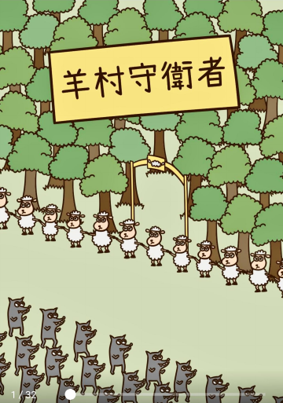
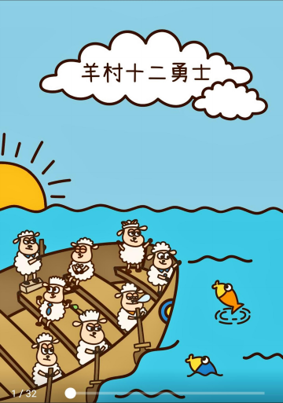
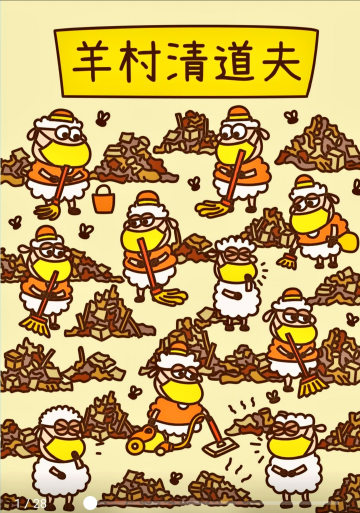
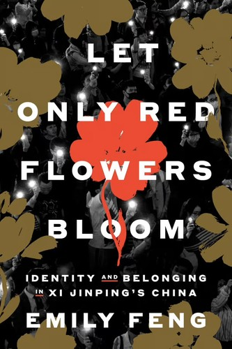
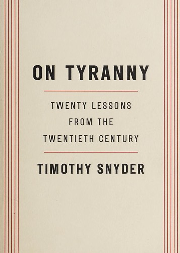
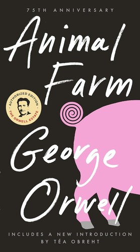

Related: [[📕 Book Censorship under the NSL|book-censorship]] | [[🐑 Sheep Village|book-censorship.sheep-village]]

The Hong Kong government has repeatedly **refused to publish a list of banned books** — in July 2026 the Secretary for Security said it never would. So there is no official catalogue of what the city has tried to make vanish. This page is an unofficial one: a growing registry of the titles that have been declared **seditious**, **pulled from library shelves**, **seized in bookshop raids** or **stopped at customs**, assembled from the court cases and news reports that actually named them. Where a cover can be shown, it is — to help readers recognise a book and look it up. For the cases themselves, see [[📕 Book Censorship under the NSL|book-censorship]].

> **This list is partial and ongoing.** It grows as new titles are seized, and much is never named publicly — the 60-plus Taiwan books taken from the [[Waiting Bird / As One group|book-censorship]] in 2026, for instance, were never itemised. If you can add a title, a cover or the case it belongs to, please **[contribute](https://github.com/China-Digital-Times-CDT/wepreserve/issues)**.

## The landmark: the Sheep Village trilogy

The three picture books that became the **first works a Hong Kong court declared "seditious publications"** — the template for everything that followed. Published by the **General Union of Hong Kong Speech Therapists**; five of its members were jailed for sedition in 2022. The archive preserves all three in full — read them in the [[Sheep Village viewer|book-censorship.sheep-village]].

  <figure style="margin:0;max-width:180px;flex:1 1 150px;">
    
    <figcaption style="font-size:0.85em;"><em>Guardians of Sheep Village</em> 羊村守衛者 (2020) — the 2019 protests</figcaption>
  </figure>
  <figure style="margin:0;max-width:180px;flex:1 1 150px;">
    
    <figcaption style="font-size:0.85em;"><em>The 12 Braves of Sheep Village</em> 羊村十二勇士 (2020) — the "Hong Kong 12"</figcaption>
  </figure>
  <figure style="margin:0;max-width:180px;flex:1 1 150px;">
    
    <figcaption style="font-size:0.85em;"><em>Janitors of Sheep Village</em> 羊村清道夫 (2021) — the 2020 medical strike</figcaption>
  </figure>

## Seized, pulled and prosecuted

Titles named in the bookshop raids and library purges of 2023–2026. Click a cover to look the book up in a library catalogue.

  <figure style="margin:0;max-width:190px;flex:1 1 160px;">
    
    <figcaption style="font-size:0.85em;line-height:1.4;"><strong><em>Let Only Red Flowers Bloom</em></strong> Emily Feng · Crown, 2025 (Taiwan ed.: Acropolis, 2026) Seized in the July 2026 Book Fair raids</figcaption>
  </figure>
  <figure style="margin:0;max-width:190px;flex:1 1 160px;">
    
    <figcaption style="font-size:0.85em;line-height:1.4;"><strong><em>On Tyranny</em></strong> Timothy Snyder · 2017 On postcards by the till at Hunter Bookstore</figcaption>
  </figure>
  <figure style="margin:0;max-width:190px;flex:1 1 160px;">
    
    <figcaption style="font-size:0.85em;line-height:1.4;"><strong><em>Animal Farm</em></strong> George Orwell · 1945 Stocked at Hunter Bookstore</figcaption>
  </figure>
  <figure style="margin:0;max-width:190px;flex:1 1 160px;">
    
cover not yet archived

    <figcaption style="font-size:0.85em;line-height:1.4;"><strong><em>The Unburned Book</em> 未燒書</strong> Yang Du (楊渡) · 2016 Sought by a reader at Hunter Bookstore</figcaption>
  </figure>
  <figure style="margin:0;max-width:190px;flex:1 1 160px;">
    
title not named

    <figcaption style="font-size:0.85em;line-height:1.4;"><strong>A biography of Jimmy Lai</strong> Seized in the Book Punch raid, March 2026 (the title was not named in reports)</figcaption>
  </figure>

*Cover images are low-resolution reproductions shown for identification (fair use), self-hosted rather than hotlinked; sourced from [Open Library](https://openlibrary.org/) and, for the Sheep Village trilogy, the archive's own preserved copies.*

## How this registry is built

Because no official list exists, this one is assembled from primary reporting and court records — each title is here because a named case, raid, removal or seizure put it there, cited on the [[main book-censorship page|book-censorship]]. It is deliberately conservative: a book is listed only when a source names it, which is why broad seizures that were never itemised do not yet appear. Submissions — a cover scan, a title, the case it belongs to — are welcome through the archive's **[submission channels](https://github.com/China-Digital-Times-CDT/wepreserve/issues)**.

## Sources

- [[📕 Book Censorship under the NSL|book-censorship]] — the cases each title is tied to, with their sources.
- [[🐑 Sheep Village|book-censorship.sheep-village]] — the trilogy, the trial, and the preserved books.
- [Open Library: *Let Only Red Flowers Bloom*](https://openlibrary.org/books/OL58298230M/Let_Only_Red_Flowers_Bloom) (Emily Feng, Crown, 2025).
- Yang Du's *The Unburned Book* (未燒書) is discussed in [Lingua Sinica](https://lingua-sinica.org/).
